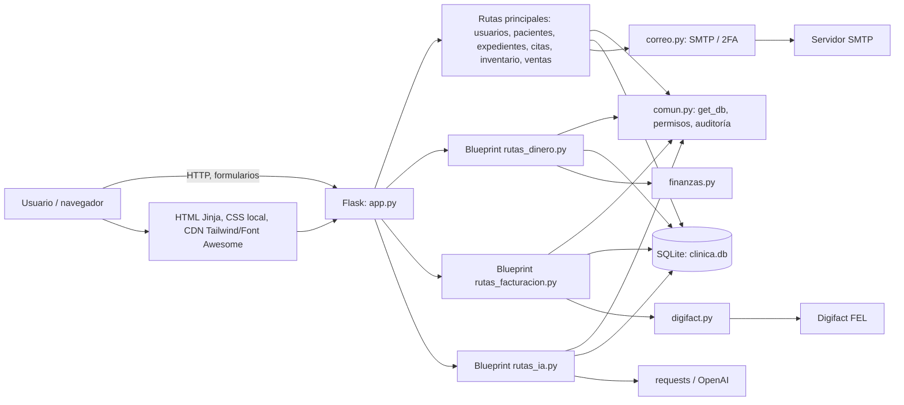
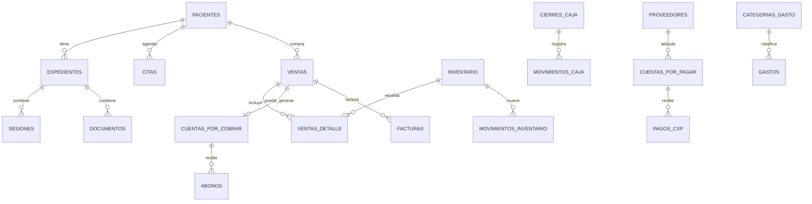

# Análisis técnico integral — Sistema de Gestión Clínica

**Fecha de revisión:** 4 de noviembre de 2026  
**Alcance:** inspección estática del código, configuración, artefactos de calidad existentes y pruebas.  
**Restricción respetada:** no se ejecutaron pruebas, no se importó la aplicación, no se abrió el contenido de ninguna base de datos, no se ejecutaron migraciones, ni se contactaron servicios externos. El único archivo creado es este informe.

> **Criterio de evidencia.** Las conclusiones se apoyan en archivos fuente y artefactos presentes. Los resultados de la ejecución anterior descritos en el encargo se tratan como datos aportados, no como una ejecución reproducida. Donde no hay salida de error con la ruta o el test específico, la explicación se marca como hipótesis.

## Resumen ejecutivo

1. La aplicación es un monolito Flask modular con plantillas Jinja, SQLite y módulos auxiliares para finanzas, correo, facturación FEL y reportes con IA. El punto de entrada es [`app.py`](./app.py#L1); al importarlo configura carpetas, crea la aplicación y llama a la inicialización de la base.
2. **SQLite es el único motor de base de datos conectado por la aplicación web.** [`comun.py`](./comun.py#L11) abre conexiones con `sqlite3`; `DATABASE_URL` solo aparece en la utilidad de migración [`migrate_sqlite_to_postgres.py`](./migrate_sqlite_to_postgres.py#L29). Esa utilidad no habilita PostgreSQL en el runtime Flask.
3. Las tres suites contienen **91 métodos `test_*` declarados**: 29, 44 y 18 respectivamente. Son `unittest.TestCase`, no requieren Pytest, aunque Pytest puede descubrir clases unittest. Las dependencias actuales no incluyen `pytest`, Ruff ni `coverage`.
4. El mayor problema confirmado de los tests de regresión es que [`test_regressions.py`](./tests/test_regressions.py#L36) accede a `app.DATABASE_URL`, atributo que no existe en [`app.py`](./app.py#L1), y usa `INITIAL_ADMIN_PASSWORD`, mientras el inicializador reconoce `CLINICA_ADMIN_PASSWORD` en [`database.py`](./database.py#L608). Además, importa la aplicación antes de preparar su entorno temporal.
5. Las dos suites anteriores cambian `os.environ['CLINICA_DB']` en tiempo de importación. Si se recolectan juntas en un solo intérprete, el módulo `app`/`database` ya importado conserva rutas globales, pero las funciones auxiliares vuelven a leer la variable de entorno modificada: se pueden consultar bases distintas y esquemas distintos. El propio [`tests/ejecutar.py`](./tests/ejecutar.py#L1) intenta reducir este problema ejecutando cada archivo en un proceso separado.
6. El artefacto existente [`coverage.xml`](./coverage.xml) indica **42.22% de cobertura de líneas (586/1388)**, por debajo del objetivo del 60%. No se regeneró ni se verificó su vigencia durante esta revisión.
7. El reporte [`ruff-inicial.json`](./ruff-inicial.json) contiene 91 hallazgos, todos con severidad `error`, distribuidos en 13 archivos. No se encontró configuración de Ruff, SonarCloud ni GitHub Actions en el directorio del proyecto.
8. No se deben correr ahora los tests tal como están: importar `app` ejecuta la inicialización/migración de la base configurada y crea directorios. La suite de regresión importa antes de aislar la base; en una máquina con datos, existe riesgo real de tocar `clinica.db` o crear respaldos.

## 1. Arquitectura general

### 1.1 Identificación y tecnologías

El README identifica el producto como un **sistema web de gestión clínica**, con pacientes, expedientes, agenda, inventario, ventas, caja, cuentas por cobrar/pagar, reportes y facturación electrónica FEL. No hay un nombre de paquete formal independiente del producto. La descripción funcional se encuentra en [`README.md`](./README.md).

| Área | Tecnología constatada | Evidencia |
|---|---|---|
| Backend | Python, Flask 3.x | [`requirements.txt`](./requirements.txt); [`app.py`](./app.py#L10) |
| Vistas | Jinja2/HTML renderizado por Flask | [`templates/`](./templates); llamadas `render_template` en `app.py` y blueprints |
| Estilos/íconos | Tailwind CSS y Font Awesome desde CDN; CSS local reducido | [`templates/layout.html`](./templates/layout.html#L1), [`static/css/expediente.css`](./static/css/expediente.css) |
| Persistencia runtime | SQLite mediante `sqlite3` | [`comun.py`](./comun.py#L33), [`database.py`](./database.py#L1) |
| Autenticación | Flask-Login; hash de contraseñas Werkzeug | [`app.py`](./app.py#L11), rutas de login y modelo `User` |
| Formularios/CSRF | Flask-WTF `CSRFProtect` global | [`app.py`](./app.py#L12) |
| Archivos XLSX | openpyxl | [`app.py`](./app.py#L14) |
| Integración HTTP | requests; Digifact, OpenAI y consulta de NIT | [`digifact.py`](./digifact.py#L1), [`rutas_ia.py`](./rutas_ia.py#L1), [`rutas_facturacion.py`](./rutas_facturacion.py#L1) |
| SMTP/cifrado | `smtplib`, `cryptography`/Fernet | [`correo.py`](./correo.py#L1), [`digifact.py`](./digifact.py#L26) |
| Servidor de producción | Gunicorn mencionado en documentación | [`README.md`](./README.md) |
| PostgreSQL | Utilidad de migración aparte; no runtime Flask | [`migrate_sqlite_to_postgres.py`](./migrate_sqlite_to_postgres.py) |

El repositorio del proyecto no declara Python mínimo/máximo ni una matriz de versiones. El intérprete que Pylance reportó como seleccionado en el entorno de revisión es Python 3.14; eso **no** constituye una declaración de compatibilidad del proyecto.

### 1.2 Estilo arquitectónico y flujo de ejecución

Es un **monolito web modular**, no una arquitectura de servicios ni una aplicación MVC separada por capas estrictas. La mayor parte de los endpoints clínicos y operativos está en `app.py` (1,836 líneas); finanzas, facturación e IA se separan en blueprints, mientras acceso a datos y reglas transversales se comparten por módulos.



### 1.3 Inicio, configuración y autenticación

- **Inicio de desarrollo:** `python app.py`; el bloque de ejecución llama a `app.run(...)` y solo permite debug cuando `FLASK_DEBUG=1` y no se detecta `FLASK_ENV=production` ([`app.py`](./app.py#L1836)).
- **Servidor documentado:** `gunicorn app:app` (el README sugiere aumentar el timeout para reportes de IA).
- **Importación con efectos:** al importar `app.py` se crea la instancia Flask, carpetas de upload/`instance`, se configura CSRF y se ejecuta `database.inicializar_base_de_datos()` ([`app.py`](./app.py#L48), [`app.py`](./app.py#L76)). Esto ocurre también al importar desde una prueba, no solo al arrancar como servidor.
- **Variables de entorno realmente leídas:** `CLINICA_DB`, `CLINICA_BACKUP_DIR` ([`database.py`](./database.py#L26)); `CLINICA_ADMIN_PASSWORD` ([`database.py`](./database.py#L608)); `SECRET_KEY`, `FLASK_ENV`, `FLASK_DEBUG` ([`app.py`](./app.py#L40)); y claves de cifrado consultadas en `digifact.py`. No se encontró carga explícita de `.env` ni `load_dotenv`.
- **Muestras posiblemente desalineadas:** `.env.example` usa `SQLITE_DB`, `APP_ENV`, `COOKIE_SECURE` e `INITIAL_ADMIN_PASSWORD`; el código no lee esos nombres para la base, ambiente, cookie o password inicial. `DATABASE_URL` se usa por el script de migración, no por Flask.
- **Autenticación:** `User` implementa Flask-Login; la ruta `/login` compara hashes Werkzeug y mantiene controles de intentos fallidos/bloqueo. El flujo de 2FA por correo se activa cuando el correo saliente se ha probado correctamente; si el usuario existente no tiene correo, se le guía para registrarlo. La evidencia está en [`app.py`](./app.py#L169) y [`correo.py`](./correo.py#L94).
- **Roles:** roles de código `admin` y `usuario`; `admin_required` en [`comun.py`](./comun.py#L164) redirige usuarios no autenticados al login y usuarios no administradores al dashboard. Las rutas administrativas agregan este decorador; el README describe la matriz funcional.
- **Controles web observables:** CSRF global; cookie `HttpOnly`, `SameSite=Lax` y `Secure` si `FLASK_ENV=production`; cabeceras `X-Content-Type-Options`, `X-Frame-Options` y `Referrer-Policy` en `app.py`. La ruta de logout, sin embargo, está registrada sin `methods` y por tanto admite GET; véase diagnóstico.

## 2. Estructura de directorios y archivos

Árbol de archivos **relevantes**; se omiten entornos virtuales, `__pycache__`, cachés, binarios, bases, respaldos y dependencias externas.

```text
clinica_web/
├── app.py                         # aplicación Flask y rutas principales
├── database.py                    # esquema SQLite, migraciones y backups
├── comun.py                       # conexión, permisos, fechas, dinero y auditoría
├── finanzas.py                    # saldos, movimientos, conciliación y estados financieros
├── rutas_dinero.py                # blueprint de caja, fondo, CxC/CxP, gastos y reportes
├── rutas_facturacion.py           # blueprint FEL, documentos y NIT
├── rutas_ia.py                    # blueprint IA, correo y configuración
├── correo.py                      # SMTP y códigos de verificación
├── digifact.py                    # cifrado y cliente de API Digifact
├── migrate_sqlite_to_postgres.py  # migrador puntual SQLite → PostgreSQL
├── corregir_ventas_pasadas.py     # script de mantenimiento; no ejecutar en CI
├── requirements.txt               # dependencias de runtime (sin dependencias de test)
├── .env.example                   # muestra de entorno; nombres no todos coinciden con el código
├── .gitignore                     # excluye DB, backups, uploads, instance y entornos
├── README.md                      # puesta en marcha y descripción funcional
├── estructura.txt                 # inventario textual generado; no es fuente ejecutable
├── ruff-inicial.json              # reporte estático existente
├── coverage.xml                   # reporte de cobertura existente
├── templates/
│   ├── layout.html, login.html, index.html, error.html
│   ├── pacientes.html, expedientes_lista.html, expediente_form.html
│   ├── citas*.html, inventario*.html, ventas*.html, usuarios.html
│   ├── caja/                      # apertura, turno, historial, movimientos
│   ├── cxc/, cxp/, gastos/, proveedores/, fondo/
│   ├── facturacion/               # configuración y documentos FEL
│   └── reportes/                  # reportes operativos, financieros e IA
├── static/
│   ├── css/expediente.css
│   └── img/                       # logotipos
└── tests/
    ├── ejecutar.py                # ejecutor unittest por subproceso/archivo
    ├── test_2fa_y_ia.py
    ├── test_dinero_y_facturacion.py
    └── test_regressions.py
```

En el directorio hay artefactos de base de datos, archivos de respaldo y carpetas `uploads/`, `instance/` y `backups/`; no se inspeccionó su contenido. `.gitignore` excluye `*.db`, `*.sqlite*`, `backups/`, `uploads/`, `instance/`, `.env` y entornos virtuales. Aun así, los artefactos ya presentes localmente deben tratarse como datos sensibles y nunca subirse como artefactos CI.

| Archivo/carpeta | Responsabilidad comprobada |
|---|---|
| [`app.py`](./app.py) | Configura Flask, login/CSRF, usuarios, pacientes, expedientes, documentos, citas, inventario, ventas y rutas de compatibilidad. |
| [`database.py`](./database.py) | Define el esquema original y migraciones v2–v4, copia previa y creación de administrador. |
| [`comun.py`](./comun.py) | `get_db`, cierre de conexión, hora local Guatemala, validaciones de dinero, permisos, paginación y auditoría. |
| [`finanzas.py`](./finanzas.py) | Métodos de pago, libro de caja/fondo, saldos, conciliación, cuentas y reportes financieros. |
| [`correo.py`](./correo.py) | SMTP, configuración, envío, verificación de códigos 2FA, expiración e intentos. |
| [`digifact.py`](./digifact.py) | Cifrado Fernet, validación de NIT, payload FEL, HTTP de Digifact y cálculos por régimen. |
| [`rutas_dinero.py`](./rutas_dinero.py) | Blueprint `dinero`: caja, fondo, CxC/CxP, gastos, categorías, proveedores y reportes. |
| [`rutas_facturacion.py`](./rutas_facturacion.py) | Blueprint `facturacion`: configuración fiscal, prueba, emisión, anulación, descarga y consulta NIT. |
| [`rutas_ia.py`](./rutas_ia.py) | Blueprint `ia`: reportes con OpenAI, almacenamiento, correo y configuración IA/SMTP. |
| [`tests/`](./tests) | Tres suites `unittest` y un ejecutor que llama cada módulo en un intérprete separado. |
| [`templates/`](./templates) | HTML Jinja por dominio funcional; el layout carga Tailwind y Font Awesome desde CDN. |
| [`static/`](./static) | Un CSS propio y logotipos; no se encontró paquete frontend/build de JavaScript. |
| [`requirements.txt`](./requirements.txt) | Flask, Flask-Login, Flask-WTF, openpyxl, requests, cryptography y gunicorn; no incluye pytest, coverage, Ruff ni psycopg2. |

## 3. Módulos funcionales

La tabla resume rutas observadas, métodos y persistencia principal; `GET` es el método Flask por defecto cuando no se declara `methods`. Los nombres de tablas se basan en el esquema de [`database.py`](./database.py), no en la lectura de registros.

| Módulo | Archivos/rutas y métodos | Operaciones/validaciones | Tablas y dependencias |
|---|---|---|---|
| Usuarios, login y permisos | `app.py`: `/login` GET/POST, `/login/verificar` GET/POST, `/login/reenviar` POST, `/logout` GET, `/usuarios` GET, `/usuarios/nuevo` POST, `/usuarios/<id>/activar` POST, `/usuarios/<id>/password` POST, `/cuenta/password` POST, `/auditoria` GET | Crear/activar usuarios, cambiar contraseñas, bloquear tras fallos, verificar email y autorización admin. Contraseñas hash; 2FA con código de un uso; CSRF global. | `usuarios`, `codigos_verificacion`, `config_correo`, `auditoria`; `correo.py`, `comun.py`. |
| Pacientes | `app.py`: `/pacientes` GET, `/pacientes/nuevo` POST, `/paciente/<id>/expedientes` GET, búsqueda `/api/pacientes/buscar` GET, papelera/restauración/eliminación POST | Alta, listado y búsqueda; borrado lógico y restauración; eliminación permanente se limita si hay historial referenciado. Validaciones en handlers/forms. | `pacientes`, `expedientes`, `ventas`, `citas`; datos clínicos deben mantenerse solo en la DB local. |
| Expedientes, sesiones y documentos | `app.py`: `/paciente/<id>/expediente/nuevo` GET/POST, `/expediente/editar/<id>` GET/POST, `/sesion/nueva/<id>` POST, `/documento/subir/<id>` POST, papelera/restauración POST; descarga `/uploads/...` GET | CRUD de expediente y sesiones; carga permitida por extensión/tamaño, nombre saneado; eliminación lógica de documentos y acciones de recuperación. | `expedientes`, `sesiones`, `documentos`, `pacientes`; almacenamiento físico en `uploads/`. |
| Citas | `app.py`: `/citas`, `/citas/historial`, `/citas/nueva` GET/POST, `/citas/editar/<id>` GET/POST, atender GET, completar/cancelar POST, APIs de búsqueda/horarios GET | Crear/editar, completar/cancelar; comprueba colisiones de horario en los tests de regresión. | `citas`, `pacientes`, `expedientes`/`ventas` en flujos enlazados. |
| Inventario | `app.py`: `/inventario` GET, exportación XLSX GET, alta/edición GET/POST, stock agregar/quitar POST, historial GET y papelera POST | CRUD de producto/servicio y movimientos de stock; valida cantidades y evita cantidades negativas en el flujo de regresión; borrado lógico. | `inventario`, `movimientos_inventario`, `ventas_detalle`; openpyxl para exportación. |
| Ventas | `app.py`: `/ventas` GET, `/ventas/nueva` GET/POST, `/ventas/cancelar/<id>` POST, `/venta/detalle/<id>` GET, créditos/pagos legacy GET | Alta y detalle; stock, descuentos, paciente/método de pago, caja abierta, idempotencia/doble clic; cancelar sujeto a permiso/estado. | `ventas`, `ventas_detalle`, `inventario`, `cierres_caja`, `movimientos_caja`, `cuentas_por_cobrar`, `abonos`, `usuarios`. |
| Caja y fondo | `rutas_dinero.py`: `/caja`, abrir/cerrar/movimiento POST, historial y detalle GET; `/fondo` GET, movimiento/consolidar POST | Apertura exige origen y saldo; cierre compara esperado/contado; ingresos/salidas con saldo suficiente; consolidación de tarjeta. Lógica central en `finanzas.py`. | `cierres_caja`, `movimientos_caja`, `movimientos_fondo`, `ventas`, `abonos`, `gastos`, `configuracion`. |
| Cuentas por cobrar | `rutas_dinero.py`: `/cuentas-por-cobrar` GET; nueva GET/POST; detalle GET; edición GET/POST; pagar/anular POST | Alta, edición, abonos y anulación; valida saldo, método y referencia. Ventas a crédito migradas desde ventas/abonos. | `cuentas_por_cobrar`, `abonos`, `pacientes`, `ventas`, movimientos de caja/fondo. |
| Cuentas por pagar y proveedores | `rutas_dinero.py`: `/proveedores` GET, alta/edición GET/POST, activar POST; `/cuentas-por-pagar` GET, nueva/editar GET/POST, pagar/anular POST | CRUD administrativo de proveedores y obligaciones, pagos parciales, reversos/validación de saldo. | `proveedores`, `cuentas_por_pagar`, `pagos_cxp`, `movimientos_*`. |
| Gastos | `rutas_dinero.py`: `/gastos` GET, nuevo/editar GET/POST, anular POST, categorías GET/POST y acciones POST | Registro de gastos operativos por categoría y forma de pago; anulación con motivo; categorías activas/inactivas. | `gastos`, `categorias_gasto`, `proveedores`, movimientos de caja/fondo. |
| Reportes | `rutas_dinero.py`: índice, ventas, productos, inventario, financiero, libro y detalle GET | Filtros de período, cálculos, listados y exportación. `finanzas.py` provee estado de resultados, flujo, obligaciones y conciliación. | Ventas, inventario, caja/fondo, CxC/CxP, gastos, `configuracion`. |
| Facturación FEL / Digifact | `rutas_facturacion.py`: config GET/POST; probar POST; documentos GET; descargar GET; facturar/anular POST; `/nit/<nit>` GET | Construye y envía FEL a Digifact; soporta régimen general/pequeño contribuyente según payload; manejo de documentos pendientes/indeterminados y descarga. Configuración/credenciales cifradas. | `config_fiscal`, `facturas`, `ventas`, `ventas_detalle`, `pacientes`; `digifact.py`, `requests`. |
| IA y correo | `rutas_ia.py`: reportes IA GET, generar POST, ver GET, enviar POST; configuración GET; configurar/probar IA y SMTP POST | Resume datos financieros, invoca OpenAI, guarda y envía reportes; valida modelo/destinatarios; las pruebas reemplazan SMTP/OpenAI por mocks. | `config_ia`, `reportes_ia`, `config_correo`, `ventas`, `gastos`, inventario y datos agregados; nunca necesita datos clínicos según el código/README. |

### Operaciones CRUD y dependencias transversales

- No todos los dominios ofrecen borrado físico: pacientes, inventario y documentos manejan papelera/eliminación lógica y algunas rutas permanentes condicionadas por referencias.
- La mayoría de las escrituras son POST y el middleware CSRF cubre formularios; endpoints de lectura usan GET.
- `comun.py` y `finanzas.py` son dependencias compartidas de los flujos de dinero, caja, ventas y reportes.
- `app.py` importa e instala los tres blueprints desde las líneas 1812–1817; por tanto los blueprints dependen del contexto Flask y de los módulos compartidos.
- Se observan declaraciones de claves foráneas en el DDL, pero `get_db()` no activa `PRAGMA foreign_keys=ON`. En SQLite, las claves foráneas no se aplican por conexión mientras no se habiliten; no debe asumirse que el DDL por sí solo impide referencias huérfanas.

## 4. Base de datos

### 4.1 Motor, conexión y compatibilidad

| Pregunta | Hallazgo |
|---|---|
| Motor del runtime | SQLite, confirmado por `sqlite3.connect` en [`comun.py`](./comun.py#L33), consultas con `?`, `sqlite3.Row`, `PRAGMA` y `sqlite_master`. |
| `CLINICA_DB` | `database.py` toma la variable una vez al importar el módulo; si no está, usa `clinica.db` junto al código. La ruta debe establecerse **antes** de importar `database`/`app`. |
| `get_db()` | En contexto Flask, abre una sola conexión SQLite por request y la guarda en `flask.g`; `close_db` la cierra al terminar. No selecciona motor por URL. |
| `DATABASE_URL` | Leída por el script de migración como destino PostgreSQL. No hay `app.DATABASE_URL`, ni selección PostgreSQL en `get_db()` o `app.py`. |
| PostgreSQL | **No compatible como backend de ejecución actual.** [`migrate_sqlite_to_postgres.py`](./migrate_sqlite_to_postgres.py) es un migrador puntual (usa psycopg2), no cambia las consultas SQLite del servidor. Además `psycopg2` no está declarado en `requirements.txt`. |
| Inicialización | `app.py` invoca `database.inicializar_base_de_datos()` durante el import. `database.py` mantiene `PRAGMA user_version`, versión actual de esquema 4, migraciones 2, 3 y 4 y transacción `BEGIN IMMEDIATE`/`COMMIT`. |
| Backup | Antes de migrar una base existente con versión inferior, copia completa vía API de backup SQLite a `CLINICA_BACKUP_DIR` (por defecto `backups/`). Existe comando manual `python database.py --respaldo`. El modo `--reset` es destructivo y **no debe usarse en CI**. |
| Migraciones | La versión 2 crea tesorería/CxC/CxP/FEL/auditoría y traslada datos históricos; la 3 agrega email, códigos 2FA y configuración/reportes IA; la 4 agrega el marcador de correo probado. Idempotencia por versión; transacción y respaldo para DB antigua. |
| Entorno temporal | El inicializador admite `inicializar_base_de_datos(ruta=...)`. Sí puede crearse una DB temporal nueva o migrar una fixture antigua; `CLINICA_DB` y `CLINICA_BACKUP_DIR` deben configurarse antes de importar módulos. El proceso de importación de `app.py` también crea carpetas en el árbol del proyecto, por lo que un runner CI debe trabajar en checkout efímero. |

La configuración de ambiente del ejemplo no coincide completamente con los nombres del runtime. Además, cambiar `os.environ['CLINICA_DB']` después de importar `database.py` no cambia `DATABASE_NAME`; `comun.DATABASE` y la constante `DATABASE` importada por `app.py` también son valores inicializados previamente.

### 4.2 Inventario del esquema actual y relaciones

El inventario se extrajo del DDL/migraciones, no de tablas/filas de las bases de datos del directorio.

| Dominio | Tablas del esquema v4 | Relaciones principales |
|---|---|---|
| Identidad y sistema | `usuarios`, `auditoria`, `configuracion` | Auditoría registra usuario opcional; configuración guarda parámetros clave-valor. |
| Clínica | `pacientes`, `expedientes`, `sesiones`, `documentos`, `citas` | Expediente y cita referencian paciente; sesión y documento referencian expediente. |
| Inventario y ventas | `inventario`, `movimientos_inventario`, `ventas`, `ventas_detalle`, `cierres_caja` | Ventas referencian paciente/cita; detalle referencia venta e inventario; movimientos de stock referencian inventario. |
| Dinero | `movimientos_caja`, `movimientos_fondo`, `cuentas_por_cobrar`, `abonos`, `proveedores`, `cuentas_por_pagar`, `pagos_cxp`, `categorias_gasto`, `gastos` | Caja-movimientos/cierres; CxC referencia paciente/venta y abonos; CxP referencia proveedor y pagos; gasto referencia categoría/proveedor según DDL. |
| FEL | `config_fiscal`, `facturas` | Factura referencia venta; configuración fiscal es singleton lógico. |
| Correo/IA | `codigos_verificacion`, `config_correo`, `config_ia`, `reportes_ia` | Códigos/reporte pueden guardar usuario; configuraciones son singleton lógico. |

La tabla antigua `abonos_gastos` y el uso antiguo de `gastos` para facturas de proveedor se convierten durante v2; el nombre `gastos` queda para gastos operativos y las obligaciones pasan a `cuentas_por_pagar`/`pagos_cxp`. `abonos_nuevo` y `gastos_nuevo` son tablas sombra transitorias durante migraciones, no entidades de negocio finales. En una instalación nueva, la ruta de creación construye la base anterior y aplica inmediatamente migraciones hasta v4.

Relaciones de mayor interés:



No se consultaron datos clínicos, ni se incluyeron valores de bases de datos.

## 5. Sistema de pruebas

### 5.1 Inventario de suites

El framework usado es `unittest` de la biblioteca estándar. Conteos por declaración estática de métodos `test_*`:

| Archivo | Pruebas declaradas | Clases | Tipo predominante | Alcance / dependencias |
|---|---:|---:|---|---|
| [`test_2fa_y_ia.py`](./tests/test_2fa_y_ia.py) | 29 | 5 | Integración Flask + pruebas unitarias puntuales | Configuración de correo/IA, 2FA, reportes, régimen pequeño contribuyente y NIT. Usa `app.test_client()`, SQLite temporal; simula SMTP y `rutas_ia.requests.post`; la suite también simula llamadas a facturación. Variables preestablecidas antes de importar `app`: `CLINICA_DB`, `CLINICA_BACKUP_DIR`, `CLINICA_ADMIN_PASSWORD`, `SECRET_KEY`, `FISCAL_ENCRYPTION_KEY`. |
| [`test_dinero_y_facturacion.py`](./tests/test_dinero_y_facturacion.py) | 44 | 2 | Integración, migración y regresión | Construye esquema antiguo ficticio en SQLite temporal, luego importa app para migrarlo; flujos de caja/fondo, ventas, CxC/CxP, gastos, permisos, CSRF, seguridad, conciliación, reportes y FEL. Digifact/request se simula con `unittest.mock`. Establece `CLINICA_DB`, `CLINICA_BACKUP_DIR` y `FISCAL_ENCRYPTION_KEY` antes de importar. |
| [`test_regressions.py`](./tests/test_regressions.py) | 18 | 1 | Regresión/integración | Flujos clínicos, ventas, caja, fechas, uploads, citas, migraciones y secuencias PostgreSQL. Usa `TemporaryDirectory` por caso, pero importa `app`/`database` al nivel del módulo antes de configurar la DB. No requiere correo/OpenAI para lo mostrado; tiene verificaciones de la utilidad PostgreSQL. |
| [`ejecutar.py`](./tests/ejecutar.py) | — | — | Orquestación | Descubre `tests/test_*.py` y ejecuta cada módulo unittest con `subprocess`, uno por proceso; el proceso se ejecuta desde la raíz de la aplicación. |

**Compatibilidad Pytest:** Pytest normalmente recoge clases derivadas de `unittest.TestCase` y métodos `test_*`, pero no está declarado ni instalado por `requirements.txt` como dependencia de proyecto. Pytest no elimina los efectos de importación ni el estado global compartido. El README/script favorece `unittest`.

**Efectos laterales identificados estáticamente:** los dos primeros tests crean directorios temporales y bases/backups; el import de `app.py` crea `uploads/`, `instance/` y otros directorios configurados en el código. `test_regressions.py` importa la app sin preparar antes una DB temporal, por lo que la inicialización puede dirigirse a `clinica.db` del proyecto. Ninguna prueba fue ejecutada en este análisis.

### 5.2 Ejecución conjunta y aislamiento

**No se consideran seguras para ejecución en un único proceso en su estado actual.**

1. `test_2fa_y_ia.py` escribe una ruta temporal en `CLINICA_DB` y luego importa `app`; `database.DATABASE_NAME`, `comun.DATABASE` y las constantes importadas por `app` quedan fijadas en ese momento.
2. `test_dinero_y_facturacion.py` cambia después `CLINICA_DB`, crea su fixture antigua mediante `sqlite3.connect(os.environ['CLINICA_DB'])`, y `app` ya puede estar en caché como módulo. Las consultas de la prueba pueden ir a la nueva DB mientras `get_db()`/rutas usan la DB que quedó fijada en el primer import.
3. La suite de regresión importa app al recolectarse y más tarde muta `database.DATABASE_NAME` y `clinic_app.DATABASE`; esto no actualiza automáticamente `comun.DATABASE`. `get_db()` lee la constante de `comun`, por lo que pueden quedar conexiones a rutas distintas.
4. Al recolectar todos los módulos, el último valor de `os.environ` puede ser visible para helpers de suites que ya importaron app, aun si `database.DATABASE_NAME` conserva otro valor. La recolección de Pytest/unittest importa los módulos antes de ejecutar todos los métodos, por lo que el orden alfabético afecta el estado.
5. [`tests/ejecutar.py`](./tests/ejecutar.py) separa los archivos en procesos y mitiga la interferencia entre módulos, pero no corrige la importación insegura de la suite de regresión ni sus referencias obsoletas.

Para un futuro pipeline, cada suite debe ser aislada y configurarse antes de cualquier import; idealmente todos los accesos a DB/upload deben depender de una configuración de aplicación inyectable y no de constantes importadas. No se requiere reescribir el sistema para empezar: se puede corregir primero el aislamiento de tests.

## 6. Diagnóstico de errores reportados

| Error/síntoma | Causa confirmada | Hipótesis adicionales / alcance | Recomendación de menor riesgo |
|---|---|---|---|
| `sqlite3.OperationalError: no such column: email` | `email` se agrega en la migración v3; el esquema base original no la contiene ([`database.py`](./database.py#L584)). Si el test consulta una fixture antigua sin pasar migraciones o abre otra DB, falla. Los módulos de test cambian rutas globales al importar. | Puede ser base con `user_version` anterior a 3, o una base marcada v4 pero con drift/corrupción. Sin URL/traceback exactos no se identifica cuál produjo el evento observado. | Configurar ruta temporal y backup antes de importar `app`; crear/migrar fixture con la API de inicialización. No agregar la columna a una DB de producción como arreglo de test. |
| `sqlite3.OperationalError: no such table: cuentas_por_cobrar` | Se crea en la migración v2; no existe en el esquema base antiguo. App/test y helper pueden apuntar a DB distintas, dejando el helper mirando una fixture sin migrar. | También es consistente con pruebas contra DB vacía/esquema incompleto o importación previa a la configuración. | Confirmar `PRAGMA user_version` y `PRAGMA table_info` solo en una DB temporal; no consultar filas reales. Asegurar inicializador v4 antes de cada suite. |
| `AttributeError: module 'app' has no attribute 'DATABASE_URL'` | **Confirmado por código:** `test_regressions.py` lee/restaura `clinic_app.DATABASE_URL`; `app.py` no define ese atributo. El runtime es SQLite y no lo necesita. | No es una incompatibilidad causada por una dependencia; es un test basado en una interfaz/configuración inexistente o eliminada. | Actualizar el test para usar la configuración realmente soportada o, preferentemente, inyectar la ruta SQLite de test. No añadir una variable `DATABASE_URL` ficticia a la aplicación para satisfacer un test desactualizado. |
| Contraseña inicial de la suite de regresión no autentica | **Confirmado:** test usa `INITIAL_ADMIN_PASSWORD`; [`database.py`](./database.py#L608) busca `CLINICA_ADMIN_PASSWORD` o genera un valor aleatorio. | Puede quedar oculto tras el `AttributeError` inicial. Si hay una DB ya inicializada, ni una ni otra cambia la contraseña existente. | Alinear el nombre de variable y crear una DB nueva vacía antes de importar. No cambiar contraseñas ni datos en la DB de trabajo. |
| Cambio de DB no llega a la aplicación | **Confirmado por diseño de importación:** `database.DATABASE_NAME`, `comun.DATABASE` y `app.DATABASE` son constantes derivadas/importadas; mutar una no actualiza las otras. `get_db()` usa `comun.DATABASE`. | Explica conexiones cruzadas y resultados no deterministas cuando se importan suites juntas. | Evitar monkeypatch parcial; configurar env antes de import o introducir una fábrica/configuración inyectable en cambios posteriores, con pruebas específicas. |
| HTTP 302 donde el test espera 200 | `login_required`/`admin_required` redirigen a login/dashboard; el login y las escrituras usan patrón Post/Redirect/Get. Las rutas legacy `/creditos` y `/pagos` redirigen por compatibilidad. | Si la prueba no autenticó un cliente, o no sigue una redirección, 302 es respuesta correcta. No hay URL concreta del log suministrado para asignar el caso exacto. | Revisar `Location`, identidad/rol y si la expectativa debe ser 302 o `follow_redirects=True`. No cambiar redirecciones válidas solo para convertirlas en 200. |
| HTTP 404 donde el test espera 200 | La app registra un handler 404 y las rutas de detalle pueden responder 404 cuando el ID no existe; fixtures que apuntan a otra DB no contienen esos IDs. También puede haber un path desactualizado. | Sin ruta concreta no se confirma si fue path inexistente, ID sin fixture, rol/flujo que no llegó a sembrar datos, o blueprint no registrado por otro import. | Capturar URL, método, `response.location` y cuerpo del handler; contrastar contra `app.url_map` y fixture temporal. |
| Incompatibilidad de logout | **Confirmada:** la ruta actual `/logout` es GET (`app.py` en la sección de login/logout), mientras `test_regressions.py` afirma que GET debe devolver 405. El test codifica una política distinta a la aplicación. | La ruta GET permite logout por navegación/CSRF; conviene decidir el contrato deliberadamente. | Menor riesgo de seguridad: acordar y probar un logout POST con CSRF, actualizar formularios/expectativas en un cambio independiente. No ocultar la discrepancia. |

### 6.1 ¿Qué pruebas/configuraciones parecen desactualizadas?

- [`test_regressions.py`](./tests/test_regressions.py#L36) asume una API PostgreSQL dentro de `app` (`DATABASE_URL`) que no existe.
- También usa `INITIAL_ADMIN_PASSWORD` en vez del nombre que consulta el inicializador. La importación al nivel de módulo precede a la instalación del entorno temporal.
- Cambia `clinic_app.DATABASE`, pero la conexión normal `get_db()` usa `comun.DATABASE`; por tanto la modificación parcial no aísla todas las rutas.
- El test que exige logout POST no coincide con `/logout` GET en la implementación.
- Los tres archivos muestran comentarios que invitan a `unittest discover`, pero la propia estructura de módulos y env global no permite asumir que una recolección conjunta sea segura.
- `test_2fa_y_ia.py` y `test_dinero_y_facturacion.py` sí configuran parte del entorno antes de importar la app, pero dependen de que cada módulo tenga proceso propio. El runner separado es el camino previsto, no `unittest discover` indiscriminado.

Los valores informados en la ejecución previa (`91` detectadas, `17` aprobadas, `61` fallidas, `29` errores de preparación y `70` subpruebas aprobadas) **no forman una partición aritmética coherente** si se interpretan como estados mutuamente excluyentes: 17+61+29=107. Podrían mezclar contadores de tests, subtests o fases del runner. Se necesita el log íntegro con versión de runner y nombres para normalizar el baseline; no se infiere que existan 107 métodos.

## 7. Calidad del código y herramientas

### 7.1 Evidencia existente

| Artefacto/herramienta | Estado |
|---|---|
| Ruff | Hay [`ruff-inicial.json`](./ruff-inicial.json) con 91 hallazgos. El número de versión 0.17.3 proviene del contexto del encargo; no está embebido en el JSON. No se encontró `ruff.toml`, `.ruff.toml` ni configuración en `pyproject.toml`. |
| Cobertura | [`coverage.xml`](./coverage.xml) conserva line-rate `0.4222`: 586 de 1,388 líneas, equivalente a 42.22%. Snapshot existente, no regenerado en esta revisión. |
| Pytest | No declarado en `requirements.txt`; los tests están escritos con `unittest`. |
| SonarCloud | No se encontró `sonar-project.properties`, workflow ni configuración de proyecto local. |
| GitHub Actions | No hay workflow bajo `.github/workflows/` en el directorio de aplicación. |
| Dependencias | `requirements.txt` contiene 7 dependencias runtime con rangos generales, sin lockfile ni separador de dev/test. psycopg2 se importa opcionalmente por el migrador, pero no está declarado. |

El JSON agrupa los 91 hallazgos: `FURB157` 29, `RUF100` 12, `I001` 11, `C408` 10, `BLE001` 5, `F401` 4, `RUF059` 4, `UP006` 3, `UP035` 3 y 10 hallazgos individuales repartidos entre `UP017`, `F541`, `FURB188`, `F841`, `RUF012`, `SIM102`, `UP031`, `SIM118`, `SIM114` y `PIE810`. Por archivo: `test_dinero_y_facturacion.py` 17, `migrate_sqlite_to_postgres.py` 15, `finanzas.py` 13, `rutas_dinero.py` 13, `app.py` 8, `test_2fa_y_ia.py` 7, `digifact.py` 5, `database.py` 3, `corregir_ventas_pasadas.py` 3, `comun.py` 2, `rutas_facturacion.py` 2, `rutas_ia.py` 2 y `test_regressions.py` 1.

### 7.2 Mantenibilidad, deuda y riesgos relevantes

- `app.py` concentra 1,836 líneas; es núcleo funcional y punto de importación que inicializa DB. Los blueprints alivian parte del monolito, pero no existe fábrica de aplicación que permita construir instancias de test aisladas.
- Hay configuración de rutas de DB y uploads por constantes globales; tests que cambian ambiente tarde o mutan atributos parciales quedan frágiles.
- No hay lockfile ni dependencias separadas de desarrollo; los rangos con `>=` permiten que builds futuros resuelvan versiones distintas. Registrar versiones instaladas en el entorno no sustituye un lockfile.
- El migrador PostgreSQL es una utilidad especializada no incluida en runtime ni validada por el flujo CI. El README documenta SQLite como base operativa.
- El código contiene un identificador de contraseña predeterminada heredada (`CLAVES_PREDETERMINADAS`) como literal. No se reproduce el valor aquí. Debe tratarse como credencial comprometida: no usar en instalaciones, rotar cualquier cuenta asociada y evitar secretos en fixtures/logs.
- Tokens y contraseñas de integraciones están diseñados para cifrarse en DB mediante Fernet, pero la clave de cifrado debe respaldarse de forma separada y secreta. CI debe usar secretos efímeros y nunca publicar variables en logs/reportes.
- El árbol local contiene bases/backups/uploads; asegurar que workflows no los empaqueten ni suban. `.gitignore` los excluye, pero debe verificarse que no haya archivos previamente rastreados.
- No se activa explícitamente `PRAGMA foreign_keys=ON` en conexiones de runtime; la integridad referencial declarada puede no ser aplicada por SQLite.
- `layout.html` depende de CDN externos para Tailwind y Font Awesome. Esto implica disponibilidad de red en navegador y riesgo de cadena de suministro; no impide tests de servidor, que no ejecutan el JavaScript.
- No se observó política CSP ni HSTS en las cabeceras añadidas por la aplicación; es una oportunidad de endurecimiento, no una causa probada de los errores de pruebas.
- La ruta `/logout` usa GET y tiene una prueba que espera método POST-only; alinear explícitamente implementación, plantillas y test.
- `corregir_ventas_pasadas.py` es un script de mantenimiento de datos; no debe importarse/ejecutarse automáticamente en CI. `migrate_sqlite_to_postgres.py` debe limitarse a tareas explícitas de migración.

### 7.3 Alcance Ruff recomendado

Incluir Python mantenido: `app.py`, `database.py`, `comun.py`, `finanzas.py`, `correo.py`, `digifact.py`, `rutas_*.py`, utilidad de migración que se mantenga y todos los tests/ejecutores. Decidir explícitamente si el script histórico `corregir_ventas_pasadas.py` sigue mantenido: no excluirlo solo para mejorar métricas, pero tampoco ejecutarlo.

Excluir del análisis/coverage: entornos virtuales, `__pycache__`, `.ruff_cache`, `.pytest_cache`, `instance/`, `uploads/`, `backups/`, DBs, binarios, salidas `coverage.xml`/`.coverage`, reportes JSON generados y copias `*.respaldo_seguridad`. El formato Ruff puede configurarse inicialmente con reglas equivalentes al reporte recibido y baseline; no activar un conjunto enorme de reglas nuevas el día de entrega sin revisar falsos positivos.

## 8. Preparación recomendada para CI/CD

### 8.1 Principios para no dañar datos ni usar servicios reales

1. `CLINICA_DB` y `CLINICA_BACKUP_DIR` deben apuntar a `$RUNNER_TEMP`/directorio temporal y definirse **antes de importar `app`**.
2. No usar `DATABASE_URL` para ejecutar la aplicación; no crear un servicio PostgreSQL si solo se prueban rutas SQLite.
3. Definir `SECRET_KEY`, `CLINICA_ADMIN_PASSWORD` y `FISCAL_ENCRYPTION_KEY` con valores de prueba efímeros; no usar secretos de producción.
4. Mantener mocks de SMTP/OpenAI/Digifact/NIT para pruebas automatizadas. La prueba real de Digifact debe ser una tarea manual contra sandbox con secretos habilitados, no un paso obligatorio de cada PR.
5. Ejecutar en checkout efímero y no subir DB, respaldos, uploads, `instance/` ni logs con payloads.
6. No usar `database.py --reset`; la DB temporal debe ser nueva por run/worker.

### 8.2 Versiones y dependencias

- **Python inicial recomendado:** 3.12 en GitHub Actions para una línea estable; el proyecto aún no declara versiones compatibles. Tras validar, agregar una matriz adicional (por ejemplo 3.13) como mejora. No usar la versión del intérprete del editor como política de soporte.
- `pip install -r requirements.txt` instala runtime. Separar luego dependencias dev/test (Ruff, Pytest si se adopta, `coverage`/`pytest-cov`) en un `requirements-dev.txt` o configuración equivalente.
- SonarCloud requiere configurar la organización/proyecto y guardar `SONAR_TOKEN` como secret del repositorio. No pasar ese token a workflows de PR de forks.

### 8.3 Etapas y comandos

| Etapa | Pasos recomendados | Estado actual |
|---|---|---|
| **BUILD** | `actions/checkout`; `actions/setup-python` con 3.12; `python -m pip install --upgrade pip`; `pip install -r requirements.txt`; instalar herramientas dev declaradas; `python -m compileall -q app.py database.py comun.py finanzas.py correo.py digifact.py rutas_dinero.py rutas_facturacion.py rutas_ia.py tests` | Requiere declarar dev dependencies. `compileall` solo verifica sintaxis/import-free y crea bytecode en checkout efímero. |
| **TEST** | Ejecutar cada suite en proceso aislado: `python -m unittest tests.test_dinero_y_facturacion -v`, luego `python -m unittest tests.test_2fa_y_ia -v`, luego `python -m unittest tests.test_regressions -v`; entorno DB/backup temporal establecido en cada proceso | No activar hasta corregir regresión de `DATABASE_URL`, variables de password/ruta y evitar import antes de aislamiento. La orden del README `python tests/ejecutar.py` es runner existente pero no garantiza que regression no inicialice DB default. |
| **ANALYZE** | `ruff check app.py database.py comun.py finanzas.py correo.py digifact.py rutas_dinero.py rutas_facturacion.py rutas_ia.py migrate_sqlite_to_postgres.py tests`; luego análisis SonarCloud usando sources/exclusions definidos | No hay configuración actual; Ruff debe instalarse solo en dev pipeline y los hallazgos deben reducirse en PRs controlados. |
| **REPORT** | `coverage report --fail-under=60`; `coverage xml -o coverage.xml`; SonarCloud Quality Gate; publicar XML/JUnit como artefactos con retención corta y sin DB/datos/uploads | Cobertura actual del XML existente: 42.22%; la etapa debe fallar si queda bajo 60%. JUnit se puede generar mediante plugin o convertir resultados, sin exponer datos. |

Ejemplo ilustrativo de entorno de job (no es un workflow creado ni ejecutado):

```yaml
env:
  CLINICA_DB: ${{ runner.temp }}/clinica-${{ github.run_id }}-${{ github.run_attempt }}.db
  CLINICA_BACKUP_DIR: ${{ runner.temp }}/clinica-backups-${{ github.run_id }}
  SECRET_KEY: ci-only-not-for-production
  CLINICA_ADMIN_PASSWORD: ci-only-temporary-password
  FISCAL_ENCRYPTION_KEY: ${{ secrets.CI_FISCAL_ENCRYPTION_KEY }}
  FLASK_ENV: testing
```

El proyecto debe revisar la variable de ambiente de testing: actualmente `IS_PRODUCTION` solo contrasta `FLASK_ENV == 'production'`, y los tests remueven `FLASK_ENV`; el ejemplo no cambia por sí solo la conexión DB. Las variables deben estar en el entorno del proceso antes de la importación, especialmente porque el import inicializa el esquema.

Para acumular cobertura con las suites aisladas, ejecutar `coverage run` por cada suite en procesos separados usando `--append` en las ejecuciones posteriores; luego `coverage combine` si se usan archivos paralelos y `coverage xml`. Ejemplo después de estabilizar las suites:

```powershell
coverage run --source=app,database,comun,finanzas,correo,digifact,rutas_dinero,rutas_facturacion,rutas_ia -m unittest tests.test_dinero_y_facturacion
coverage run --append --source=app,database,comun,finanzas,correo,digifact,rutas_dinero,rutas_facturacion,rutas_ia -m unittest tests.test_2fa_y_ia
coverage run --append --source=app,database,comun,finanzas,correo,digifact,rutas_dinero,rutas_facturacion,rutas_ia -m unittest tests.test_regressions
coverage report --fail-under=60
coverage xml
```

Estos comandos son una propuesta de configuración, no resultados. Para CI Linux se traducen a variables de entorno `NAME=value`; evitar que `coverage` mida tests/`migrate_sqlite_to_postgres.py` si el indicador exigido es cobertura de aplicación.

### 8.4 SonarCloud, Quality Gate y rama principal

- Configurar `sonar-project.properties` con `sonar.sources=.` y `sonar.tests=tests`; excluir entornos, caches, DB/backups/uploads, bytecode, artefactos y los tests de las métricas de código fuente.
- Enviar cobertura Python generada con `coverage xml` mediante `sonar.python.coverage.reportPaths=coverage.xml`.
- Definir gate para cobertura mínima 60% (inicialmente puede aplicarse a código nuevo para no bloquear por deuda preexistente, y luego elevar el gate total), cero bugs/vulnerabilidades nuevos y revisión de hotspots.
- Workflow debe correr en `pull_request` y `push` a `main`, usar permisos mínimos (`contents: read`), acciones fijadas por versión/commit revisada y separar build/test/analyze/report con `needs`.
- En ajustes de repositorio: proteger `main`, exigir PR, al menos una aprobación según rúbrica, todos los checks CI obligatorios y conversación resuelta; bloquear force push y eliminación. No aceptar secrets en PRs de forks.
- Reporte de CI debe incluir commit, Python, conteo de pruebas, cobertura, Ruff, Sonar Quality Gate y enlaces a artefactos seguros; no almacenar logs con datos clínicos o secretos.

## 9. Plan urgente de implementación

No implica reescritura. Debe completarse en orden, porque el workflow no debe convertirse en un indicador engañoso si tests apuntan a DB distinta.

| Prioridad | Actividad | Archivos/configuración que se modificarían después | Verificación |
|---|---|---|---|
| **Crítica 1** | Aislar inicialización de DB por suite; corregir test de regresión (`DATABASE_URL`, password inicial, DB temporal y constantes compartidas) antes de importar app. | `tests/test_regressions.py`, posiblemente `tests/test_2fa_y_ia.py`, `tests/test_dinero_y_facturacion.py`, `tests/ejecutar.py`; como mejora pequeña/arquitectónica `app.py`/`comun.py` para configuración inyectable. | Verificar que cada proceso escribe únicamente en `$RUNNER_TEMP`; inspeccionar ruta de DB efectiva antes de ejecutar; no abrir DB real. |
| **Crítica 2** | Alinear contratos de rutas: 302 esperados para login/POST-Redirect-GET, 404 por ID ausente, y discrepancia de logout GET vs POST. | `tests/test_regressions.py`, `app.py`, plantillas que incluyen logout. | Pruebas explícitas de status/location con cliente autenticado y anónimo; CSRF válido/inválido. |
| **Crítica 3** | Agregar workflow build/test y asegurar dependencies de tests; habilitar ejecución separada de las suites hasta eliminar globales compartidas. | `.github/workflows/ci.yml`, `requirements-dev.txt` o equivalente, quizá `tests/ejecutar.py`. | Workflow en PR con DB temporal; todas las suites finalizan sin network; smoke test de inicialización nueva en un directorio temporal. |
| **Crítica 4** | Elevar cobertura desde el snapshot 42.22% a ≥60% con pruebas centradas en rutas/reglas de mayor riesgo. | `tests/`, configuración coverage, CI. | `coverage report --fail-under=60` y `coverage.xml` nuevo; verificar que scope no incluye tests. |
| **Crítica 5** | Proteger rama `main` y exigir status checks. | Configuración del repositorio GitHub (no es archivo fuente). | PR de prueba bloqueado por check fallido y merge habilitado solo tras check verde. |
| **Importante** | Configurar Ruff, revisar hallazgos actuales por prioridad en vez de aplicar autocorrección masiva. | `pyproject.toml` o `ruff.toml`; módulos listados en el reporte. | `ruff check ...` en local y CI; baseline anterior preservado para comparar. |
| **Importante** | Configurar SonarCloud y Quality Gate, primero sobre código nuevo y luego elevar cobertura total. | `sonar-project.properties`, workflow, secrets del repo. | Análisis de PR muestra gate, cobertura y exclusiones correctas; revisar que el token no aparezca en logs. |
| **Importante** | Alinear `.env.example`/README con nombres de variables que realmente lee el código; documentar que el runtime es SQLite. | `.env.example`, `README.md`. | Prueba de arranque temporal con nombres canónicos; no hacer deploy de PostgreSQL por configurar solo `DATABASE_URL`. |
| **Opcional** | Matriz Python adicional, escaneo de dependencias, chequeo de secretos y una prueba manual de sandbox FEL. | Workflow y configuración de seguridad; secretos/entorno sandbox. | Solo tras tener CI estable; sandbox con credenciales de prueba y aprobación manual. |
| **Opcional** | Reducir acoplamiento del `app.py` con fábrica de aplicación y configuración inyectable; activar claves foráneas si se valida compatibilidad. | `app.py`, `comun.py`, tests y migraciones. | Suite de regresión, migración de fixture antigua, integridad referencial; cambio separado y revisado. |

**Secuencia de entrega recomendada para el día siguiente:** (1) corregir aislamiento y API obsoleta en tests; (2) ejecutar cada archivo separadamente contra DB temporal hasta conocer el baseline real; (3) configurar BUILD/TEST; (4) fijar y reportar coverage 60%; (5) configurar Ruff y Sonar; (6) exigir checks y proteger `main`; (7) adjuntar reporte y evidencias. No reportar como aprobado un gate que no corrió o un umbral de cobertura no alcanzado.

## 10. Checklist final para el equipo

- [ ] Variables temporales definidas antes de importar `app`; confirmar la ruta efectiva de `database.DATABASE_NAME` y `comun.DATABASE`.
- [ ] Ningún test usa `clinica.db`, `backups/`, uploads reales o credenciales productivas.
- [ ] Suites ejecutadas por proceso aislado hasta eliminar el estado global.
- [ ] Corregido contrato del test de regresión sobre `DATABASE_URL` y `INITIAL_ADMIN_PASSWORD`.
- [ ] 302/404 evaluados contra URL, sesión, rol y fixture exactos; evitar cambiar comportamiento correcto por expectativas obsoletas.
- [ ] Logout y CSRF tienen contrato consistente en código y pruebas.
- [ ] Cobertura nueva ≥60% y reporte XML reproducible.
- [ ] Ruff configurado; los 91 hallazgos actuales se comparan con baseline.
- [ ] SonarCloud recibe cobertura y Quality Gate es requerido en PR.
- [ ] CI no sube DBs, backups, uploads, `instance/`, secretos ni datos clínicos.
- [ ] `main` protegida y sin pushes directos.
- [ ] Se archivan evidencias de build, pruebas, coverage, Ruff y gate con commit asociado.

## Fuentes de evidencia revisadas

El análisis se basó en el código y estructura reales del directorio de aplicación, especialmente [`app.py`](./app.py), [`database.py`](./database.py), [`comun.py`](./comun.py), [`finanzas.py`](./finanzas.py), [`correo.py`](./correo.py), [`digifact.py`](./digifact.py), [`rutas_dinero.py`](./rutas_dinero.py), [`rutas_facturacion.py`](./rutas_facturacion.py), [`rutas_ia.py`](./rutas_ia.py), [`migrate_sqlite_to_postgres.py`](./migrate_sqlite_to_postgres.py), los tres archivos de [`tests/`](./tests), [`requirements.txt`](./requirements.txt), [`.env.example`](./.env.example), [`.gitignore`](./.gitignore), [`README.md`](./README.md), [`ruff-inicial.json`](./ruff-inicial.json) y [`coverage.xml`](./coverage.xml). No se inspeccionaron contenidos de bases ni datos de pacientes y no se ejecutó código de la aplicación.
