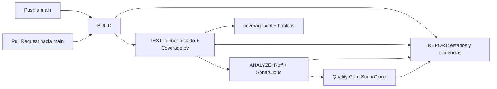

# Implementación de CI/CD con GitHub Actions

## Alcance y estado

Se preparó un pipeline de integración continua para la aplicación Flask existente. Ejecuta build/sintaxis, las suites aisladas, el quality gate de cobertura, Ruff y, una vez configurado el proyecto, SonarCloud. No incluye Docker ni despliegue.

La aplicación inicializa SQLite durante la importación de `app.py`. El workflow no la importa en BUILD; TEST invoca `tests/ejecutar.py --coverage`, que crea un directorio temporal independiente por suite y configura allí la base y sus respaldos antes de arrancar cada proceso. Ningún artefacto publicado incluye bases, respaldos, uploads, `instance/` ni logs de pruebas.

La configuración local está preparada, pero **no se ha ejecutado en GitHub Actions ni se ha conectado a SonarCloud**. La validación local no demuestra que las credenciales, variables o Quality Gate remotos estén configurados correctamente.

## Arquitectura



Los jobs `BUILD`, `TEST` y `ANALYZE` son dependencias obligatorias de `REPORT`. Este último usa `if: always()` para producir un resumen incluso con fallos, pero termina en error si cualquiera de esos jobs no tuvo resultado `success`. No hay pasos de despliegue.

## Jobs

### BUILD

- Usa GitHub-hosted `ubuntu-latest` y Python 3.12.
- Instala `requirements-dev.txt` (dependencias runtime y versiones fijas de herramientas de calidad).
- Analiza sintácticamente los archivos Python de raíz y `tests/` con `ast.parse`, sin importar módulos ni inicializar la aplicación/base.

### TEST

- Se ejecuta solo después de BUILD exitoso.
- Ejecuta `python tests/ejecutar.py --coverage`; el runner inicia cada suite en su propio proceso y directorio temporal.
- Comprueba la salida de las suites y falla si el total no es exactamente 91, además de conservar el código de salida del runner.
- Genera el reporte de consola/XML/HTML y aplica `coverage report --fail-under=60`.
- Falla si alguna suite falla o el porcentaje es menor a 60%.
- Publica por siete días `coverage.xml`, `htmlcov/` y `.coverage.sqa`, incluso si fallan las pruebas y esos reportes llegaron a generarse.

### ANALYZE

- Se ejecuta después de BUILD y TEST, por lo que recibe el XML de cobertura consolidado.
- Ejecuta `ruff check .`; la regla usa el conjunto de códigos de la línea base Ruff y analiza los archivos Python, incluidos tests y scripts de mantenimiento. Solo excluye carpetas generadas/entornos en `ruff.toml`.
- Conserva `ruff-final.json` como artefacto de evidencia.
- En push y PR desde la misma organización/repositorio exige `SONAR_TOKEN`, `SONAR_ORGANIZATION` y `SONAR_PROJECT_KEY`; ejecuta el scanner y espera el Quality Gate.
- Para PR desde forks, Ruff se ejecuta, pero SonarCloud se omite porque GitHub no entrega secretos del repositorio a workflows de forks. Esa condición aparece como aviso; el resultado de ese PR no demuestra el Quality Gate de SonarCloud.

### REPORT

- Se ejecuta siempre que GitHub pueda iniciar el job, incluso si una dependencia falla o fue omitida.
- Resume los resultados de BUILD, TEST, ANALYZE y SonarCloud en el resumen de Actions y en `ci-summary.md`.
- Intenta descargar evidencias de cobertura/Ruff, y publica el resumen y las evidencias disponibles por siete días.
- Finaliza con error si BUILD, TEST o ANALYZE falla o se omite. Por ello, no convierte un fallo obligatorio en éxito.

## Archivos creados o modificados

| Archivo | Propósito |
|---|---|
| `.github/workflows/ci.yml` | Pipeline de cuatro jobs y triggers para push/PR hacia `main`. |
| `ruff.toml` | Selección explícita de reglas reportadas en la línea base y exclusión de entornos/artefactos generados. |
| `sonar-project.properties` | Alcance de análisis Flask/Python, descubrimiento de tests, exclusiones y reporte Cobertura XML. |
| `requirements-dev.txt` | Fija `coverage==7.17.2` y `ruff==0.17.3`, además de incluir dependencias runtime. |
| `tests/ejecutar.py` | Añade `--coverage`; combina las mediciones de procesos aislados, genera reportes y aplica mínimo 60%. |
| `app.py`, `comun.py`, `database.py`, `digifact.py`, `finanzas.py`, `rutas_dinero.py`, `rutas_facturacion.py`, `rutas_ia.py`, `migrate_sqlite_to_postgres.py`, `corregir_ventas_pasadas.py` y `tests/*.py` | Correcciones Ruff seguras o estilísticas. No se ejecutaron scripts de mantenimiento ni migraciones. |
| `.gitignore` | Ignora los resultados generados de Coverage.py y el JSON Ruff final. |
| `ruff-inicial.json` | Línea base existente de 91 hallazgos; se conserva sin alterar para comparación. |

El análisis configurado actualmente no reporta hallazgos Ruff (`ruff check .` pasa). Se habilitó `E402` junto con `RUF100`: parte de los hallazgos iniciales `RUF100` eran anotaciones `noqa: E402` intencionales en imports que deben ocurrir después de configurar el entorno de pruebas. Los cinco `BLE001` que quedan intencionalmente justificados están marcados solo en sus líneas donde se requiere revertir una transacción completa o devolver un error desde el límite de CLI; no se deshabilitó la regla globalmente. La línea base inicial y la salida final son comparables en intención, pero la selección configurada incorpora explícitamente `E402`.

Las correcciones Ruff no cambiaron reglas clínicas/financieras. Se verifican con las 91 pruebas aisladas y la medición de cobertura en local antes de entregar.

## Quality Gates

| Gate | Condición de aprobación |
|---|---|
| Sintaxis BUILD | Todos los archivos Python seleccionados analizan con `ast.parse`. |
| Tests | Las 91 pruebas existentes finalizan correctamente y el job comprueba que se ejecutaron exactamente 91. |
| Cobertura | Cobertura de líneas consolidada ≥ 60%; la ejecución local final aprobó con 72,79% (2.838/3.899), mostrado como 73% por Coverage.py. |
| Ruff | `ruff check .` sin hallazgos pendientes. |
| SonarCloud | Quality Gate remoto `PASSED` en pushes y PRs donde los secretos estén disponibles. |
| REPORT | BUILD, TEST y ANALYZE exitosos; cualquier fallo o job obligatorio omitido da resultado no exitoso. |

## Validación local

Desde la raíz de la aplicación:

```powershell
Set-Location 'C:\SQA_Proyecto_Final\clinica_web_20260926_125213\clinica_web'
& 'C:\SQA_Proyecto_Final\.venv\Scripts\python.exe' -c "import ast,pathlib; files=sorted(pathlib.Path('.').glob('*.py'))+sorted(pathlib.Path('tests').glob('*.py')); [ast.parse(p.read_text(encoding='utf-8-sig'), filename=str(p)) for p in files]; print(f'{len(files)} Python files parsed')"
& 'C:\SQA_Proyecto_Final\.venv\Scripts\python.exe' -m ruff check .
& 'C:\SQA_Proyecto_Final\.venv\Scripts\python.exe' 'tests\ejecutar.py' --coverage
& 'C:\SQA_Proyecto_Final\.venv\Scripts\python.exe' -m coverage report --fail-under=60
```

Validaciones aplicadas a los archivos generados:

- Workflow: VS Code `Problems` no reportó errores para `ci.yml`; además se revisaron las indentaciones, expresiones, dependencias entre jobs y bloques `run`. No había un parser YAML independiente ni `actionlint` disponible en el entorno. Por tanto, queda pendiente confirmar el workflow con la validación del servidor al ejecutar el primer run en GitHub; no se afirma que haya sido ejecutado allí.
- Ruff: `ruff check .` pasa localmente con Ruff 0.17.3.
- Tests/cobertura: ejecutar el comando aislado indicado; no usar `unittest discover` directo porque las suites comparten globals e inicializan la base al importar.
- SonarCloud: no verificable localmente hasta configurar e invocar el proyecto remoto.

## Configuración manual requerida en GitHub

### 1. Preparar el repositorio y `main`

1. Asegúrate de que estos cambios y los documentos/requisitos previos estén en la rama del repositorio cuyo nombre predeterminado será `main`.
2. No agregues `clinica.db`, otros `*.db`/`*.sqlite*`, carpetas `backups/`, `uploads/`, `instance/` ni datos clínicos al commit. El workflow solo publica rutas explícitamente permitidas.
3. En **Settings → Actions → General**, confirma que se permitan GitHub Actions y las acciones del marketplace usadas por el workflow.

### 2. Crear/configurar el proyecto en SonarCloud

1. Inicia sesión en SonarCloud con GitHub e importa el repositorio real.
2. Selecciona la organización que realmente contiene el proyecto y copia su **organization key**.
3. Copia el **project key** del proyecto creado/importado.
4. Genera un token de análisis desde SonarCloud con permisos de análisis para ese proyecto. No inventes ni reutilices credenciales de producción.
5. En GitHub, abre **Settings → Secrets and variables → Actions**:
   - **New repository secret:** `SONAR_TOKEN` = token real de análisis.
   - **New repository variable:** `SONAR_ORGANIZATION` = organization key real.
   - **New repository variable:** `SONAR_PROJECT_KEY` = project key real.
6. Conserva el Quality Gate deseado en SonarCloud y confirma que la cuenta/token tenga permiso de análisis. El workflow espera hasta 300 segundos por el resultado; un gate fallido hace fallar ANALYZE.

No se colocan identificadores inventados en `sonar-project.properties`: el workflow entrega los dos valores reales al scanner como propiedades `-Dsonar.organization` y `-Dsonar.projectKey`. `SONAR_TOKEN` se suministra solo como variable de entorno de las acciones oficiales y nunca se escribe en un archivo o línea de comando.

### 3. Activar workflow y proteger PRs

1. Publica el workflow a GitHub manualmente (commit y push los realiza el responsable del repositorio; no se hizo desde esta sesión).
2. Verifica **Actions → Clinic SQA CI**. El primer run se dispara al hacer push a `main` o abrir/sincronizar un PR con destino `main`.
3. En **Settings → Branches** o **Rules → Rulesets**, crea regla para `main`:
   - exigir Pull Request antes de merge;
   - exigir los checks `BUILD`, `TEST`, `ANALYZE` y `REPORT`;
   - bloquear pushes directos según política del curso/equipo.
4. No marques el primer workflow como validado hasta inspeccionar su run completo y confirmar el artifact `coverage-report`, `ruff-report` y `ci-summary`.

En un PR desde un fork, SonarCloud se omite por la protección de secretos de GitHub. Si la rúbrica requiere el gate Sonar en cada PR externo, usa una estrategia de contribución segura (por ejemplo, ejecución manual del responsable en una rama confiable); no expongas el token a código de forks.

## Evidencias que conviene capturar

- Vista del run con los cuatro jobs y sus estados.
- Log BUILD con Python 3.12 y resultado de sintaxis.
- Log TEST mostrando los 29 + 44 + 18 casos, total 91 y cobertura ≥60%.
- Artifact `coverage-report` con XML y HTML; comprobar sus conteos, sin descargar archivos de base.
- Log Ruff y `ruff-report`; comparar 91 hallazgos de `ruff-inicial.json` con la salida final.
- Resultado `PASSED` del Quality Gate de SonarCloud y URL del análisis.
- Configuración de protección de `main` mostrando PR requerido y checks obligatorios.
- Asociar cada evidencia al SHA del commit o PR correspondiente.

No capturar ni incluir valores secretos, DBs, respaldos, uploads, carpetas `instance/` o datos clínicos.

## Limitaciones y pasos pendientes

- No hay organización, project key ni token real proporcionados en este entorno. SonarCloud queda preparado pero el workflow rechazará un push a `main` o PR interno hasta que se configuren los dos variables y el secreto requeridos.
- No existe una ejecución de GitHub Actions de este pipeline todavía; la sintaxis local y las pruebas locales no demuestran una ejecución remota.
- Pull requests desde forks no reciben `SONAR_TOKEN`, así que su Quality Gate remoto no se verifica en ese evento.
- El proyecto no documenta oficialmente su matriz soportada de Python. CI selecciona Python 3.12 conforme a la recomendación del análisis, no como certificación de todas las versiones.
- `requirements.txt` mantiene rangos amplios para paquetes runtime y no hay lockfile. Las herramientas de calidad están fijadas, pero la resolución transitiva runtime podría variar; generar un lockfile y validar una matriz de Python son mejoras posteriores.
- No se agregó un umbral de cobertura por módulo ni branch coverage; el Quality Gate local evalúa líneas agregadas del conjunto de nueve módulos y mantiene el mínimo 60%.
- No hay despliegue automático, Docker, ejecución de migraciones ni servicios externos reales en el pipeline.
