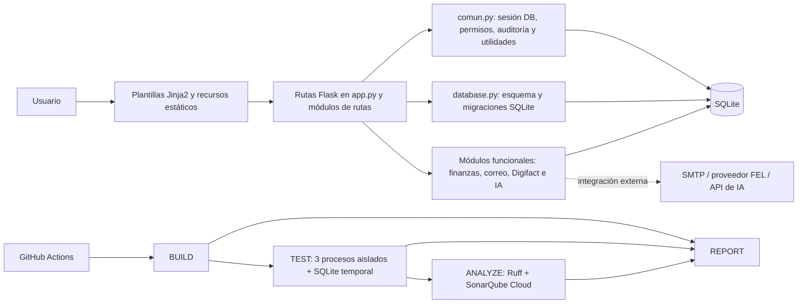

# Plan de Aseguramiento de la Calidad del Software

## 1. Introducción

Este plan describe cómo se asegura y verifica la calidad del Sistema de Gestión Clínica, una aplicación web existente desarrollada con Python, Flask, Jinja2 y SQLite. Se enfoca en el trabajo de calidad realizado para el proyecto académico de Aseguramiento de la Calidad del Software (SQA): pruebas automatizadas aisladas, medición de cobertura, análisis estático, integración continua, seguimiento de defectos y evidencias reproducibles.

El documento describe el estado respaldado por el código, la configuración y las ejecuciones identificadas en GitHub. No representa una certificación formal del producto ni afirma que el sistema esté libre de defectos.

## 2. Descripción del sistema

La aplicación es un monolito Flask modular para gestionar pacientes y expedientes, agenda, inventario, ventas, caja, cuentas por cobrar/pagar, gastos, reportes, facturación electrónica FEL, correo con verificación en dos pasos e informes asistidos por IA. La persistencia de runtime se implementa en SQLite.

El flujo general es:

La documentación funcional y los principales archivos se describen en [README.md](../README.md) y en [Manual-Tecnico.md](Manual-Tecnico.md).

## 3. Objetivo general

Establecer un proceso repetible que detecte regresiones y problemas de calidad antes de integrar cambios a `main`, protegiendo los datos clínicos reales y sin debilitar las validaciones del sistema.

## 4. Objetivos específicos

- Ejecutar las 91 pruebas automatizadas en suites y procesos independientes.
- Mantener cada suite aislada con una base SQLite temporal y datos ficticios.
- Exigir cobertura de líneas consolidada de al menos 60%.
- Ejecutar Ruff sin hallazgos pendientes dentro de las reglas configuradas.
- Analizar código y cobertura en SonarQube Cloud y verificar su Quality Gate.
- Hacer que la integración de cambios pase por Pull Request y por los checks obligatorios.
- Registrar resultados, defectos, riesgos y evidencia sin incluir datos clínicos, secretos o archivos locales de la base.

## 5. Alcance

### Incluido

- Los nueve módulos de producción incluidos en `.coveragerc`: `app`, `database`, `comun`, `finanzas`, `correo`, `digifact`, `rutas_dinero`, `rutas_facturacion` y `rutas_ia`.
- Las suites `tests/test_2fa_y_ia.py`, `tests/test_dinero_y_facturacion.py` y `tests/test_regressions.py`.
- BUILD, TEST, ANALYZE y REPORT del workflow `.github/workflows/ci.yml`.
- Cobertura de líneas con Coverage.py, Ruff, SonarQube Cloud, protección de `main` y revisión por Pull Request.
- Integraciones externas simuladas durante las pruebas.

### Fuera del alcance actual

- Certificación normativa formal, pruebas de carga/estrés, pentest o verificación exhaustiva de todas las ramas.
- Despliegue automático, Docker y migraciones ejecutadas contra una base real.
- Pruebas contra servicios reales de SMTP, IA o Digifact.
- Garantía de que un Quality Gate aprobado signifique ausencia de vulnerabilidades globales.

## 6. Normas y buenas prácticas de referencia

Se toman como referencias para organizar el trabajo, sin declarar certificación ni conformidad formal:

| Referencia | Uso en el proyecto |
|---|---|
| ISO/IEC/IEEE 29119, pruebas de software | Planificación, diseño, ejecución y registro de pruebas. |
| ISO/IEC 25010, modelos de calidad de producto | Discusión de confiabilidad, seguridad, mantenibilidad y adecuación funcional. |
| PEP 8 y guía de Ruff | Convenciones de estilo y análisis estático del código Python. |
| OWASP ASVS y buenas prácticas de desarrollo seguro | Orientación para autenticación, control de acceso, CSRF, validación y manejo de secretos. |
| Prácticas de CI/CD de GitHub Actions | Automatización, checks obligatorios, artefactos limitados y protección de ramas. |

El uso de estas referencias no equivale a una auditoría de conformidad ni a una certificación ISO u OWASP.

## 7. Estrategia de pruebas

El runner `tests/ejecutar.py` descubre las suites y ejecuta cada una en un proceso independiente. Antes de importar la aplicación, establece `CLINICA_DB`, `CLINICA_BACKUP_DIR`, `CLINICA_TEST_ROOT` y secretos ficticios. El runner comprueba que las rutas de base de datos y respaldo estén contenidas en el directorio temporal de la suite y que no existan al iniciar. También retira un `DATABASE_URL` heredado del entorno.

Las suites prueban flujos Flask con cliente de prueba, reglas de persistencia sobre SQLite temporal y casos de regresión. Las integraciones de correo, IA y facturación se sustituyen con dobles de prueba; no se envían correos ni se hacen llamadas reales a proveedores. Las pruebas de migración a PostgreSQL ejercitan validaciones con dobles y no requieren una instancia de PostgreSQL.

No ejecutar `unittest discover` directamente para estas suites: el runner es el punto de entrada soportado porque las suites históricamente compartían módulos globales y la aplicación puede inicializar SQLite al importarse.

## 8. Tipos de pruebas automatizadas

| Tipo | Aplicación en las suites |
|---|---|
| Integración | Interacción entre cliente Flask, autenticación/CSRF, rutas, SQLite temporal y módulos funcionales. |
| Regresión | Comprobación de correcciones previas: permisos, fechas, conciliación, cancelaciones, migraciones y compatibilidad de rutas. |
| Unitaria acotada | Algunas utilidades y funciones de fecha, cálculos o validaciones ejercitadas sin un flujo completo. No se clasifica la totalidad de las 91 como unitarias. |

El detalle de cada método está en [Matriz-Pruebas.md](Matriz-Pruebas.md).

## 9. Herramientas

| Herramienta | Propósito |
|---|---|
| `unittest` | Framework de las tres suites existentes. |
| `tests/ejecutar.py` | Aislamiento por proceso/suite, bases temporales y consolidación de resultados. |
| Coverage.py 7.17.2 | Cobertura de líneas, reportes XML/HTML y umbral local. |
| Ruff 0.17.3 | Análisis estático y reglas de estilo/calidad seleccionadas. |
| GitHub Actions | Automatización de BUILD, TEST, ANALYZE y REPORT en push y Pull Request a `main`. |
| SonarQube Cloud | Análisis de calidad, cobertura importada y Quality Gate remoto. |
| SQLite | Motor temporal usado por las pruebas y motor de persistencia de runtime. |

## 10. Gestión de defectos

Un fallo de prueba se trata como defecto o discrepancia por investigar. El runner debe conservar el nombre de la prueba, la ubicación y el tipo/motivo resumido, sin volcar cuerpos HTML, tokens, contraseñas ni datos clínicos. No se permiten reintentos automáticos para ocultar inestabilidad ni cambios de aserciones sin evidencia de que la expectativa original era obsoleta.

Los defectos se corrigen en cambios pequeños revisados mediante Pull Request. Cada corrección debe incluir evidencia de reproducción o una prueba de regresión cuando corresponda. En este proyecto, la incidencia temporal de conciliación se resolvió fijando los datos de prueba al periodo histórico del corte, no cambiando la lógica financiera.

## 11. Criterios de entrada y salida

| Fase | Criterios de entrada | Criterios de salida |
|---|---|---|
| BUILD | Código fuente disponible; dependencias de desarrollo instalables. | Sintaxis válida para los archivos seleccionados y dependencias disponibles. |
| TEST | BUILD aprobado; runner/configuración presentes; datos de prueba ficticios. | Se ejecutaron 91 casos, todas las suites terminan correctamente y cobertura consolidada ≥60%. |
| ANALYZE | BUILD y TEST aprobados; Ruff y configuración Sonar disponibles; variables/secreto de análisis configurados en GitHub. | Ruff sin hallazgos pendientes; análisis Sonar procesado y Quality Gate verificado para ese análisis. |
| REPORT | Cualquier estado de los jobs anteriores. | Resume los estados reales; no informa éxito global si falla un job obligatorio. |
| Merge a `main` | Pull Request y checks requeridos por el ruleset. | Checks requeridos aprobados y conversaciones resueltas conforme a la regla activa. |

## 12. Métricas de calidad

- Casos automatizados: 91 ejecutados; el run verde de `main` reportó 29, 44 y 18 por suite.
- Cobertura local consolidada: 2.838 de 3.899 líneas, 72,79%; el gate mínimo es 60%.
- Cobertura SonarQube Cloud: 72,7% en la medición pública consultada; los conteos de Coverage.py y Sonar no se presentan como idénticos.
- Ruff: 91 hallazgos en la línea base inicial y cero hallazgos en la configuración final ejecutada localmente.
- SonarQube Cloud global: Quality Gate `OK`; el análisis también informa una vulnerabilidad abierta de severidad BLOCKER. El gate y las métricas globales se documentan por separado.
- CI: los cuatro jobs de la ejecución exitosa indicada en [Linea-Base-Calidad.md](Linea-Base-Calidad.md) finalizaron correctamente.

Estas métricas son una fotografía de las ejecuciones identificadas, no una garantía permanente para cambios futuros.

## 13. Quality Gates

| Gate | Condición requerida |
|---|---|
| BUILD | Los archivos Python seleccionados pasan `ast.parse`. |
| TEST | Las tres suites terminan con código cero y el workflow verifica exactamente 91 casos. |
| Coverage.py | `coverage report --fail-under=60`; genera XML y HTML consolidados. |
| Ruff | `ruff check .` sin findings bajo la configuración versionada. |
| SonarQube Cloud | El análisis se procesa y el Quality Gate remoto se verifica; un gate fallido hace fallar ANALYZE. |
| REPORT | Informa estados observados y no convierte un fallo obligatorio en éxito. |
| Protección `main` | Pull Request requerido, checks BUILD/TEST/ANALYZE/REPORT requeridos y conversaciones resueltas. No se afirma que la regla requiera una aprobación de reviewer. |

## 14. Gestión de riesgos

| Riesgo | Tratamiento / estado |
|---|---|
| Acceso accidental a `clinica.db` o respaldos reales desde tests | El runner prepara rutas temporales antes de importar Flask y verifica contención. No ejecutar suites con otro punto de entrada. |
| Datos clínicos expuestos en logs/artefactos | Datos ficticios, resumen de fallos sanitizado y artefactos limitados a reportes permitidos. Revisar cualquier ampliación del workflow. |
| Servicios externos consumidos durante pruebas | Mock/patch en las suites; cualquier integración nueva debe simularse antes de incorporarla. |
| Falsos positivos/negativos por fecha o zona horaria | Usar fecha de clínica en filtros de reportes y fechas explícitas en fixtures históricas; evitar dependencias accidentales del reloj del host. |
| Cobertura confundida con suficiencia o seguridad | Cobertura de líneas no mide aserciones, ramas ni ausencia de vulnerabilidades; priorizar código sin pruebas. |
| Finding global de open redirect | Sonar reporta `pythonsecurity:S5146` como vulnerabilidad abierta en `app.py`; requiere triage y corrección/revisión futura. No se afirma explotación confirmada. |
| Deriva de dependencias | `requirements-dev.txt` fija las herramientas de calidad, pero las dependencias runtime usan rangos y no existe lockfile. |
| Servicios externos no validados en vivo | Pruebas usan respuestas simuladas; integración real de Digifact/SMTP/IA sigue fuera de la verificación automatizada. |

## 15. Responsabilidades

Los roles se asignan por función académica/equipo, no por una persona específica:

- **Desarrollo:** implementa cambios y conserva reglas de negocio.
- **QA:** mantiene la matriz, diseña escenarios, verifica resultados y registra defectos.
- **Revisor/a de Pull Request:** revisa impacto, evidencia, datos sensibles y checks obligatorios.
- **Responsable del repositorio:** mantiene secretos/variables de Actions, ruleset y conexión SonarQube Cloud.
- **Docente/evaluador:** revisa artefactos, métricas y evidencias entregadas.

## 16. Integración continua

El workflow [ci.yml](../.github/workflows/ci.yml) se activa con push a `main` y Pull Request hacia `main`. BUILD instala dependencias y verifica sintaxis; TEST corre las suites aisladas y Coverage.py; ANALYZE ejecuta Ruff y SonarQube Cloud; REPORT resume los estados y conserva evidencias seguras. No hay despliegue automático.

La rama `main` tiene activo el ruleset `Proteccion-main`. El detalle del estado remoto y las URLs de ejecución están en [Linea-Base-Calidad.md](Linea-Base-Calidad.md) y [GUIA_EVIDENCIAS.md](GUIA_EVIDENCIAS.md).

## 17. Resultados y conclusiones

La última ejecución remota verificada del workflow completó BUILD, TEST, ANALYZE y REPORT. TEST contó 29 + 44 + 18 = 91 casos y el propio workflow comprobó `Test cases executed: 91; expected: 91`. La medición local de cobertura superó el mínimo de 60%, y Ruff finalizó sin findings en la verificación local.

El proceso proporciona gates útiles para el alcance académico y ha mejorado la reproducibilidad. Permanecen riesgos que requieren seguimiento, especialmente la vulnerabilidad global reportada por SonarQube Cloud, las funciones sin cobertura y la ausencia de pruebas reales de integraciones externas. La matriz y la guía de evidencias detallan las limitaciones sin presentar el análisis como garantía de ausencia de defectos.
